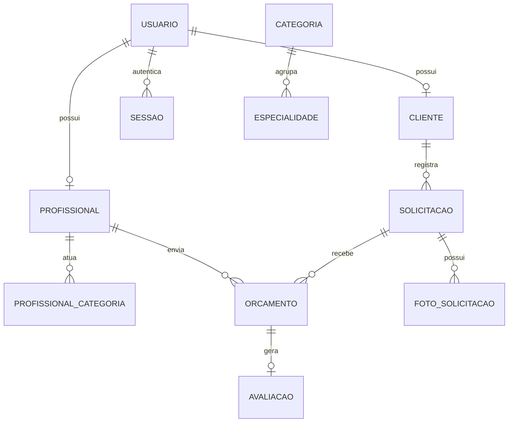

<div align="center">

# Conserta Aqui

**Encontrar quem resolve ficou mais fácil.**

Plataforma de serviços de reparo que conecta quem tem um objeto danificado a profissionais da sua cidade — da descrição do problema à comparação de orçamentos.

[](https://nextjs.org/)
[](https://www.prisma.io/)
[](https://www.postgresql.org/)
[](https://zod.dev/)
[](https://nodejs.org/)
[](https://github.com/ProjEngSoft/Projeto-Scrum---ES-1)

[Documento de Visão](docs/doc-visao.md) · [Documento de Modelos](docs/doc-modelos.md) · [Repositório](https://github.com/ProjEngSoft/Projeto-Scrum---ES-1)

</div>

<a id="sobre"></a>

## Sobre o projeto

O **Conserta Aqui** nasce de uma situação comum: quando algo quebra, nem sempre sabemos **quem conserta**, **quanto custa** ou **se vale mais a pena comprar um novo**. A ideia é reunir essas informações em um só lugar para apoiar a decisão do usuário e incentivar o reparo em vez do descarte.

O produto prevê três perfis:

| Perfil | Papel na plataforma |
|---|---|
| **Cliente** | Descreve o objeto danificado, busca profissionais, solicita e compara orçamentos. |
| **Profissional** | Divulga serviços, informa categoria/especialidades e região, responde solicitações. |
| **Administrador** | Modera conteúdo, gerencia categorias e analisa denúncias/sugestões. |

> Projeto desenvolvido na disciplina de **Engenharia de Software 1**, com Scrum e entregas iterativas. O escopo completo está registrado no [Documento de Visão](docs/doc-visao.md).

<a id="status"></a>

## O que já existe e o que vem a seguir

A discriminação abaixo é feita com base no código atual do repositório — não em uma estimativa.

### Implementado

- Cadastro de conta com nome, e-mail, senha e telefone opcional.
- Login com hash bcrypt e sessão persistida no PostgreSQL.
- Cookie de sessão `HttpOnly`, `SameSite=Lax` e `Secure` em produção.
- Página `/home` protegida com consulta de dados da conta.
- Edição de nome, e-mail, telefone e CPF, com validação e checagem de unicidade.
- Alteração de senha com conferência da senha atual.
- Exclusão lógica da conta: sessões revogadas e dados pessoais anonimizados (LGPD).
- Validação de entrada com **Zod** em todas as operações de conta.
- Seed com categorias, especialidades aprovadas e usuário administrador inicial.
- Restrições `CHECK` no banco (nota 1–5, valores não negativos, documento por tipo de pessoa, tamanho de foto).
- Testes automatizados com o test runner nativo do Node.js.

### Planejado (documentado, ainda sem implementação)

- Perfil profissional completo (categorias, especialidades, região e horários).
- Cadastro de objeto danificado com fotos e localização.
- Busca de profissionais por categoria e região.
- Solicitação, envio e comparação de orçamentos.
- Comparação entre custo do reparo e preço de um produto novo equivalente.
- Avaliações, denúncias e área administrativa.
- Recuperação de senha.

<a id="stack"></a>

## Stack

| Camada | Tecnologia | Versão declarada |
|---|---|---|
| Interface | Next.js (App Router) + React | `^16.4.6` |
| Ações no servidor | Server Actions | nativas do Next.js |
| Validação | Zod | `^3.25.76` |
| Acesso a dados | Prisma Client | `^6.19.3` |
| Banco de dados | PostgreSQL (`16-alpine` via Docker Compose) | — |
| Hash de senha | bcryptjs (10 rounds) | `^3.0.3` |
| Sessão | Token aleatório + hash SHA-256 no banco | nativo (`node:crypto`) |
| Testes | Node.js test runner | nativo |

<a id="estrutura"></a>

## Estrutura

```text
.
├── app/
│   ├── actions/usuarioActions.js   # Server Actions de login, conta e sessão
│   ├── cadastro/                   # rota /cadastro
│   ├── home/                       # rota /home (autenticada)
│   ├── page.js                     # rota / (login)
│   └── layout.js
├── lib/
│   ├── auth.js                     # cookie da sessão no Next.js
│   ├── authCore.js                 # tokens, hashes e consulta de sessão
│   ├── prisma.js                   # PrismaClient singleton
│   ├── services/usuarioService.js  # regras de negócio da conta
│   └── validators/                 # schemas Zod
├── prisma/
│   ├── schema.prisma               # modelos e enums do domínio
│   ├── migrations/                 # migração inicial + constraints CHECK
│   └── seed.js                     # categorias, especialidades e admin
├── tests/                          # testes de validação e integração com o banco
├── docs/                           # documentação da disciplina
└── docker-compose.yml              # PostgreSQL local
```

### Modelo de dados (resumo)



> O esquema completo já contempla todas as entidades do produto, mas nem todas possuem interface implementada. Detalhes em [docs/doc-modelos.md](docs/doc-modelos.md).

<a id="rotas"></a>

## Rotas

| Rota | Descrição | Acesso |
|---|---|---|
| `/` | Login e apresentação da plataforma | público |
| `/cadastro` | Criação de conta (perfil inicial: cliente) | público |
| `/home` | Dados da conta, segurança e exclusão | exige sessão ativa |

<a id="executar"></a>

## Como executar localmente

**Pré-requisitos:** Node.js compatível com Next.js 16 (recomenda-se Node 20 LTS ou superior), npm e Docker com Docker Compose — ou um PostgreSQL 16 local.

```bash
# 1. Instale as dependências
npm install

# 2. Configure o ambiente (nunca versionar o .env)
cp .env.example .env

# 3. Suba o banco de dados
docker compose up -d

# 4. Gere o client, aplique as migrações e popule o banco
npm run db:generate
npm run db:migrate
npm run db:seed

# 5. Inicie a aplicação
npm run dev
```

Acesse **http://localhost:3000**. O seed cria um administrador inicial usando `SEED_ADMIN_EMAIL` e `SEED_ADMIN_PASSWORD` do `.env` — altere essas credenciais antes de qualquer uso fora do ambiente local.

<a id="scripts"></a>

## Scripts

| Comando | O que faz |
|---|---|
| `npm run dev` | Inicia o servidor de desenvolvimento |
| `npm run build` | Gera a build de produção |
| `npm run start` | Executa a build de produção |
| `npm run db:generate` | Gera o Prisma Client a partir do schema |
| `npm run db:migrate` | Cria/aplica migrações em desenvolvimento |
| `npm run db:migrate:deploy` | Aplica migrações em produção |
| `npm run db:seed` | Popula categorias, especialidades e administrador |
| `npm run db:studio` | Abre o Prisma Studio |
| `npm test` | Executa os testes em `tests/*.test.mjs` |

<a id="testes"></a>

## Testes

```bash
npm test
```

Os testes estão divididos em dois grupos:

- `usuario-validator.test.mjs` — validações puras (CPF, e-mail, senha), sem depender do banco.
- `db-auth.test.mjs` — integração com PostgreSQL: cadastro, hash, login, sessão, constraints e fluxo completo da conta. **Requer o banco subido e as migrações aplicadas**, e cria/remove registros com prefixo de teste.

<a id="seguranca"></a>

## Segurança

- Senhas armazenadas somente como hash **bcrypt** (10 rounds); o hash nunca é devolvido à interface.
- Tokens de sessão gerados com `crypto.randomBytes(32)`; apenas o **hash SHA-256** é persistido.
- Validação obrigatória no servidor com Zod, além das restrições do banco.
- Mensagens de erro genéricas para credenciais inválidas.
- Contas bloqueadas não conseguem autenticar; sessões expiradas são removidas.
- Exclusão de conta é lógica: e-mail e telefone são anonimizados, CPF removido e sessões revogadas.

<a id="documentacao"></a>

## Documentação

- [Documento de Visão](docs/doc-visao.md) — produto, personas, requisitos funcionais/não funcionais e riscos.
- [Documento de Modelos](docs/doc-modelos.md) — modelos conceitual e de dados, dicionário e regras de integridade.

---

<p align="center">
  <sub>Projeto de Engenharia de Software 1 · <a href="https://github.com/ProjEngSoft/Projeto-Scrum---ES-1">ProjEngSoft/Projeto-Scrum---ES-1</a> ·</sub>
</p>
