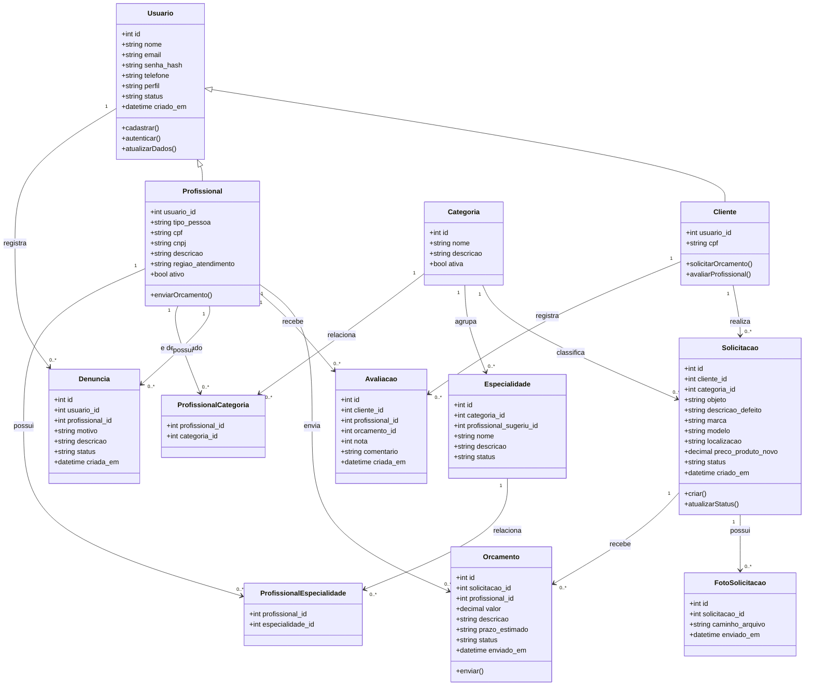
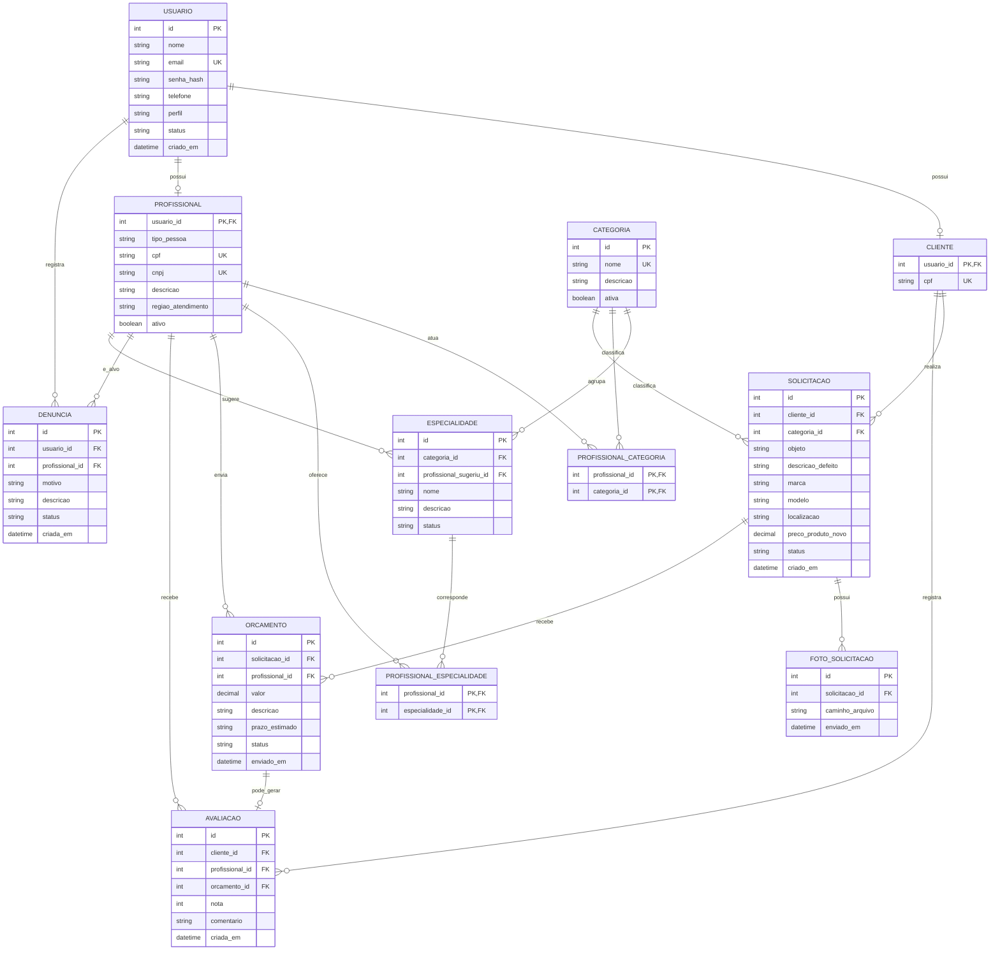

# Documento de Modelos 

Neste documento temos o modelo Conceitual (UML) ou de Dados (Entidade-Relacionamento). Temos também a descrição das entidades e o dicionário de dados.

## Modelo Conceitual

O modelo conceitual apresenta as principais classes do sistema, seus atributos, operações e relacionamentos. O diagrama abaixo utiliza a notação UML por meio da linguagem Mermaid.

### Diagrama de Classes usando Mermaid

### Observações sobre o modelo conceitual

- `Usuario` representa os dados comuns de uma conta. `Cliente` e `Profissional` são especializações de usuário e possuem informações e operações específicas.
- O administrador é representado por uma conta de `Usuario` com perfil e permissões administrativas; por isso, não foi criado como uma entidade independente neste modelo.
- Um profissional pode atuar em várias categorias e possuir várias especialidades. As classes associativas representam esses relacionamentos.
- Uma categoria pode agrupar várias especialidades.
- Uma solicitação pode receber vários orçamentos e possuir várias fotos.
- O modelo considera que uma avaliação está relacionada a um cliente, a um profissional e a um orçamento.

## Descrição das Entidades

Esta seção descreve a responsabilidade de cada entidade representada no modelo de dados.

| Entidade | Descrição |
|---|---|
| **USUARIO** | Armazena os dados comuns de acesso e identificação dos usuários do sistema, incluindo clientes, profissionais e administradores. |
| **CLIENTE** | Armazena informações específicas de usuários que solicitam serviços de reparo. |
| **PROFISSIONAL** | Armazena informações específicas de prestadores de serviços, como tipo de pessoa, documento, descrição e região de atendimento. |
| **CATEGORIA** | Representa os grupos gerais de serviços ou objetos, utilizados para organizar as solicitações e a atuação dos profissionais. |
| **ESPECIALIDADE** | Representa uma atividade específica vinculada a uma categoria. Pode ser cadastrada conforme as regras de gerenciamento definidas para o sistema. |
| **PROFISSIONAL_CATEGORIA** | Entidade associativa que registra as categorias nas quais cada profissional atua. |
| **PROFISSIONAL_ESPECIALIDADE** | Entidade associativa que registra as especialidades oferecidas por cada profissional. |
| **SOLICITACAO** | Armazena os dados do objeto danificado e do serviço de reparo solicitado pelo cliente. |
| **FOTO_SOLICITACAO** | Armazena os caminhos dos arquivos de imagem associados a uma solicitação. |
| **ORCAMENTO** | Registra a proposta de preço e prazo enviada por um profissional para atender a uma solicitação. |
| **AVALIACAO** | Armazena a nota e o comentário registrados pelo cliente sobre o atendimento do profissional. |
| **DENUNCIA** | Registra denúncias feitas por usuários relacionadas a profissionais, para análise e tratamento administrativo. |

## Modelo de Dados (ER)

O Modelo Entidade-Relacionamento representa a organização lógica dos dados que serão armazenados no banco de dados. O diagrama identifica as entidades, seus principais atributos, chaves primárias (PK), chaves estrangeiras (FK) e relacionamentos.

### Diagrama Entidade-Relacionamento usando Mermaid

### Regras e observações do modelo ER

1. Cada registro de `CLIENTE` e de `PROFISSIONAL` corresponde a um usuário. O campo `usuario_id` funciona simultaneamente como chave primária e estrangeira.
2. O campo `email` de `USUARIO` deve ser único.
3. O CPF do cliente deve ser único. Para o profissional, deve ser informado o documento compatível com o tipo de pessoa: CPF para pessoa física ou CNPJ para pessoa jurídica.
4. A aplicação deve validar que o profissional informe apenas o documento correspondente ao seu `tipo_pessoa`.
5. `PROFISSIONAL_CATEGORIA` e `PROFISSIONAL_ESPECIALIDADE` utilizam chaves primárias compostas para evitar a repetição do mesmo vínculo.
6. Uma solicitação pertence a um cliente e está associada a uma categoria.
7. Uma solicitação pode possuir várias fotos e receber vários orçamentos.
8. Cada orçamento está associado a uma solicitação e ao profissional que o enviou.
9. A avaliação deve estar relacionada a um atendimento efetivamente realizado, conforme as regras de negócio que forem definidas pela equipe.
10. O campo `nota` da avaliação deve aceitar somente valores de 1 a 5.
11. Valores monetários, como preço do produto novo e valor do orçamento, não podem ser negativos.
12. A sugestão e a aprovação de novas especialidades devem seguir a regra de negócio definida pela equipe. Caso seja adotada aprovação administrativa, o campo `status` poderá registrar estados como pendente, aprovada ou rejeitada.
13. O administrador é identificado pelo perfil e pelas permissões armazenadas na conta de usuário, sem necessidade de uma tabela separada neste modelo.

## Dicionário de Dados

O dicionário de dados apresenta a finalidade de cada tabela e descreve seus atributos, tipos e restrições. Os tipos indicados são genéricos e deverão ser adaptados ao Sistema Gerenciador de Banco de Dados (SGBD) escolhido.

### Tabela USUARIO

**Descrição:** armazena os dados comuns de identificação e acesso dos usuários do sistema.

| Atributo | Descrição | Tipo | Tamanho | Restrições |
|---|---|---|---|---|
| id | Identificador do usuário | Inteiro | — | PK, obrigatório, autoincremento |
| nome | Nome completo | Texto | 150 | Obrigatório |
| email | Endereço de e-mail | Texto | 150 | Obrigatório, único |
| senha_hash | Senha armazenada em formato de hash | Texto | 255 | Obrigatório |
| telefone | Telefone de contato | Texto | 20 | Opcional |
| perfil | Perfil de acesso | Texto | 20 | Obrigatório; valores controlados pela aplicação |
| status | Situação da conta | Texto | 20 | Obrigatório |
| criado_em | Data e hora do cadastro | Data/hora | — | Obrigatório |

### Tabela CLIENTE

**Descrição:** armazena os dados específicos de um usuário que utiliza a plataforma para solicitar serviços.

| Atributo | Descrição | Tipo | Tamanho | Restrições |
|---|---|---|---|---|
| usuario_id | Identificador do usuário associado | Inteiro | — | PK, FK para USUARIO.id, obrigatório |
| cpf | Cadastro de Pessoa Física | Texto | 11 | Obrigatório, único, validar formato |

### Tabela PROFISSIONAL

**Descrição:** armazena os dados específicos de um prestador de serviços.

| Atributo | Descrição | Tipo | Tamanho | Restrições |
|---|---|---|---|---|
| usuario_id | Identificador do usuário associado | Inteiro | — | PK, FK para USUARIO.id, obrigatório |
| tipo_pessoa | Indica pessoa física ou jurídica | Texto | 20 | Obrigatório |
| cpf | CPF do profissional pessoa física | Texto | 11 | Único quando informado |
| cnpj | CNPJ do profissional pessoa jurídica | Texto | 14 | Único quando informado |
| descricao | Apresentação e informações profissionais | Texto | 1000 | Opcional |
| regiao_atendimento | Região em que atende | Texto | 255 | Opcional |
| ativo | Indica se o perfil profissional está ativo | Booleano | — | Obrigatório |

**Observação:** a aplicação deve exigir CPF quando `tipo_pessoa` indicar pessoa física e CNPJ quando indicar pessoa jurídica. A equipe deve definir se uma mesma conta poderá possuir simultaneamente os perfis de cliente e profissional.

### Tabela CATEGORIA

**Descrição:** armazena categorias gerais usadas para organizar serviços e solicitações.

| Atributo | Descrição | Tipo | Tamanho | Restrições |
|---|---|---|---|---|
| id | Identificador da categoria | Inteiro | — | PK, obrigatório, autoincremento |
| nome | Nome da categoria | Texto | 100 | Obrigatório, único |
| descricao | Descrição da categoria | Texto | 500 | Opcional |
| ativa | Indica se a categoria está disponível | Booleano | — | Obrigatório |

### Tabela ESPECIALIDADE

**Descrição:** armazena especialidades específicas vinculadas a uma categoria. O campo de sugestão identifica o profissional que propôs a especialidade, quando aplicável.

| Atributo | Descrição | Tipo | Tamanho | Restrições |
|---|---|---|---|---|
| id | Identificador da especialidade | Inteiro | — | PK, obrigatório, autoincremento |
| categoria_id | Categoria à qual pertence | Inteiro | — | FK para CATEGORIA.id, obrigatório |
| profissional_sugeriu_id | Profissional que sugeriu a especialidade | Inteiro | — | FK para PROFISSIONAL.usuario_id, opcional |
| nome | Nome da especialidade | Texto | 100 | Obrigatório |
| descricao | Descrição da especialidade | Texto | 500 | Opcional |
| status | Situação da especialidade | Texto | 20 | Obrigatório; por exemplo, pendente, aprovada ou rejeitada |

### Tabela PROFISSIONAL_CATEGORIA

**Descrição:** relaciona profissionais às categorias em que atuam. Essa tabela resolve o relacionamento muitos-para-muitos entre PROFISSIONAL e CATEGORIA.

| Atributo | Descrição | Tipo | Tamanho | Restrições |
|---|---|---|---|---|
| profissional_id | Identificador do profissional | Inteiro | — | PK composta, FK para PROFISSIONAL.usuario_id |
| categoria_id | Identificador da categoria | Inteiro | — | PK composta, FK para CATEGORIA.id |

### Tabela PROFISSIONAL_ESPECIALIDADE

**Descrição:** relaciona profissionais às especialidades que oferecem. Essa tabela resolve o relacionamento muitos-para-muitos entre PROFISSIONAL e ESPECIALIDADE.

| Atributo | Descrição | Tipo | Tamanho | Restrições |
|---|---|---|---|---|
| profissional_id | Identificador do profissional | Inteiro | — | PK composta, FK para PROFISSIONAL.usuario_id |
| especialidade_id | Identificador da especialidade | Inteiro | — | PK composta, FK para ESPECIALIDADE.id |

### Tabela SOLICITACAO

**Descrição:** armazena os dados dos objetos danificados para os quais o cliente procura um serviço de reparo.

| Atributo | Descrição | Tipo | Tamanho | Restrições |
|---|---|---|---|---|
| id | Identificador da solicitação | Inteiro | — | PK, obrigatório, autoincremento |
| cliente_id | Cliente que criou a solicitação | Inteiro | — | FK para CLIENTE.usuario_id, obrigatório |
| categoria_id | Categoria do objeto ou serviço | Inteiro | — | FK para CATEGORIA.id, obrigatório |
| objeto | Nome ou identificação do objeto | Texto | 150 | Obrigatório |
| descricao_defeito | Descrição do problema apresentado | Texto | 2000 | Obrigatório |
| marca | Marca do objeto | Texto | 100 | Opcional |
| modelo | Modelo do objeto | Texto | 100 | Opcional |
| localizacao | Localização ou região relacionada ao atendimento | Texto | 255 | Obrigatório |
| preco_produto_novo | Preço estimado de um produto novo equivalente | Decimal | 10,2 | Opcional, não negativo |
| status | Situação atual da solicitação | Texto | 30 | Obrigatório |
| criado_em | Data e hora de criação | Data/hora | — | Obrigatório |

### Tabela FOTO_SOLICITACAO

**Descrição:** armazena referências aos arquivos de imagem enviados para ilustrar uma solicitação.

| Atributo | Descrição | Tipo | Tamanho | Restrições |
|---|---|---|---|---|
| id | Identificador da foto | Inteiro | — | PK, obrigatório, autoincremento |
| solicitacao_id | Solicitação à qual a foto pertence | Inteiro | — | FK para SOLICITACAO.id, obrigatório |
| caminho_arquivo | Caminho ou referência do arquivo armazenado | Texto | 500 | Obrigatório |
| enviado_em | Data e hora do envio | Data/hora | — | Obrigatório |

### Tabela ORCAMENTO

**Descrição:** registra as propostas enviadas por profissionais para atender às solicitações dos clientes.

| Atributo | Descrição | Tipo | Tamanho | Restrições |
|---|---|---|---|---|
| id | Identificador do orçamento | Inteiro | — | PK, obrigatório, autoincremento |
| solicitacao_id | Solicitação relacionada | Inteiro | — | FK para SOLICITACAO.id, obrigatório |
| profissional_id | Profissional que enviou a proposta | Inteiro | — | FK para PROFISSIONAL.usuario_id, obrigatório |
| valor | Valor proposto pelo profissional | Decimal | 10,2 | Obrigatório, não negativo |
| descricao | Detalhes do serviço proposto | Texto | 2000 | Obrigatório |
| prazo_estimado | Prazo previsto para realização do serviço | Texto | 100 | Opcional |
| status | Situação do orçamento | Texto | 30 | Obrigatório |
| enviado_em | Data e hora de envio | Data/hora | — | Obrigatório |

### Tabela AVALIACAO

**Descrição:** armazena a avaliação feita pelo cliente sobre o serviço prestado pelo profissional.

| Atributo | Descrição | Tipo | Tamanho | Restrições |
|---|---|---|---|---|
| id | Identificador da avaliação | Inteiro | — | PK, obrigatório, autoincremento |
| cliente_id | Cliente que realizou a avaliação | Inteiro | — | FK para CLIENTE.usuario_id, obrigatório |
| profissional_id | Profissional avaliado | Inteiro | — | FK para PROFISSIONAL.usuario_id, obrigatório |
| orcamento_id | Orçamento relacionado ao atendimento | Inteiro | — | FK para ORCAMENTO.id, obrigatório |
| nota | Nota atribuída ao profissional | Inteiro | — | Obrigatório, de 1 a 5 |
| comentario | Comentário escrito pelo cliente | Texto | 1000 | Opcional |
| criada_em | Data e hora do registro | Data/hora | — | Obrigatório |

### Tabela DENUNCIA

**Descrição:** armazena denúncias registradas por usuários sobre profissionais, para posterior análise administrativa.

| Atributo | Descrição | Tipo | Tamanho | Restrições |
|---|---|---|---|---|
| id | Identificador da denúncia | Inteiro | — | PK, obrigatório, autoincremento |
| usuario_id | Usuário que registrou a denúncia | Inteiro | — | FK para USUARIO.id, obrigatório |
| profissional_id | Profissional denunciado | Inteiro | — | FK para PROFISSIONAL.usuario_id, obrigatório |
| motivo | Motivo principal da denúncia | Texto | 150 | Obrigatório |
| descricao | Detalhamento da denúncia | Texto | 2000 | Opcional |
| status | Situação da análise da denúncia | Texto | 30 | Obrigatório |
| criada_em | Data e hora do registro | Data/hora | — | Obrigatório |

## Regras Gerais de Integridade e Validação

- Os identificadores das entidades devem ser únicos.
- Os campos definidos como obrigatórios não podem ser armazenados vazios.
- O e-mail de cada usuário deve ser único e validado pela aplicação.
- Senhas não devem ser armazenadas em texto puro; deve ser armazenado somente um hash seguro.
- Chaves estrangeiras devem garantir que os registros relacionados existam.
- A exclusão de registros relacionados deve respeitar as regras de integridade e o histórico necessário ao sistema.
- CPF e CNPJ devem ser validados conforme o tipo de pessoa informado.
- Valores monetários não podem ser negativos.
- A nota de uma avaliação deve estar no intervalo de 1 a 5.
- Arquivos enviados devem ter tipo e tamanho validados pela aplicação.
- Dados pessoais devem ser tratados conforme os princípios e requisitos da Lei Geral de Proteção de Dados Pessoais (LGPD).

## 8. Referências

- Documento de Visão do projeto ConsertAí.
- Product Backlog e planejamento do projeto ConsertAí.
- Mermaid. **Documentação da sintaxe de diagramas de classes:** https://mermaid.js.org/syntax/classDiagram.html
- Mermaid. **Documentação da sintaxe de diagramas ER:** https://mermaid.js.org/syntax/entityRelationshipDiagram.html
- Brasil. **Lei nº 13.709, de 14 de agosto de 2018 — Lei Geral de Proteção de Dados Pessoais (LGPD).**
