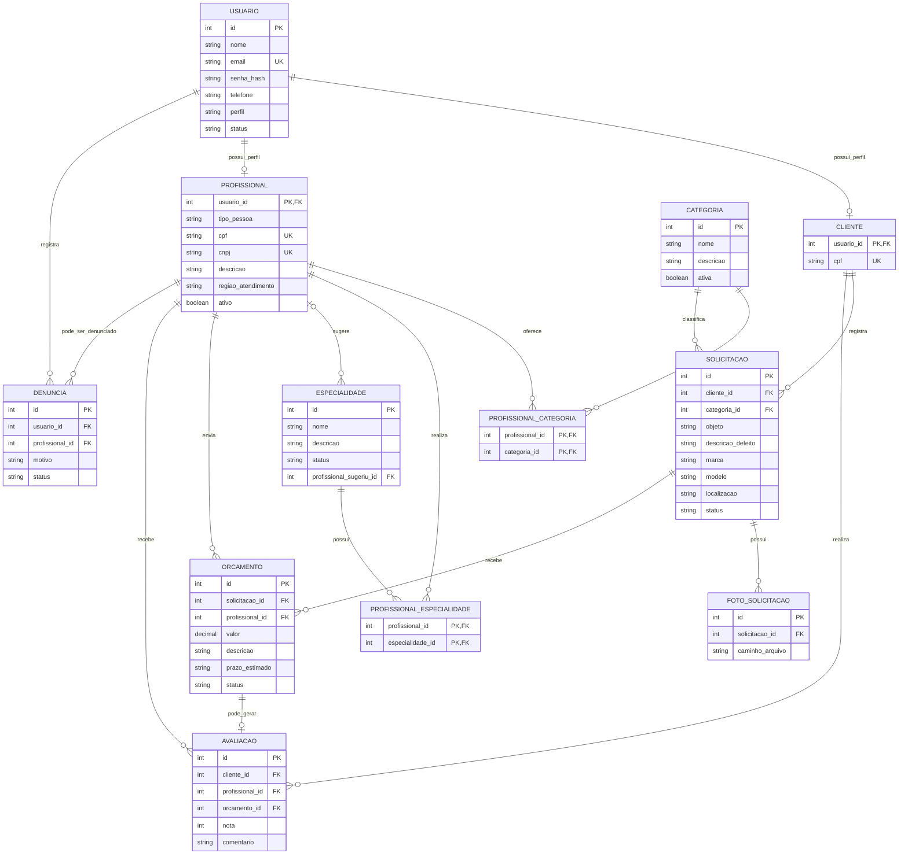

# Documento de Visão

Documento elaborado com base no **Modelo BSI - Doc 001 - Documento de Visão**, no documento de planejamento *Conserta Aqui — Product Backlog e Planejamento do Projeto com Scrum* e nas informações disponíveis no repositório do projeto.

Modelo de referência: https://docs.google.com/document/d/1DPBcyGHgflmz5RDsZQ2X8KVBPoEF5PdAz9BBNFyLa6A/edit?usp=sharing

## Descrição do Projeto

O **Conserta Aqui** é uma plataforma digital que tem como objetivo conectar pessoas que possuem objetos danificados a profissionais que oferecem serviços de reparo. A proposta é facilitar a busca por prestadores de serviço, a descrição dos problemas encontrados nos objetos, a solicitação e o recebimento de orçamentos e a comparação entre o custo do conserto e o preço de um produto novo equivalente.

O projeto busca atender a uma situação comum: quando um objeto apresenta defeito, muitas pessoas não sabem quanto custará o reparo, quais profissionais realizam aquele serviço ou se vale a pena consertar o objeto em vez de substituí-lo. A plataforma pretende centralizar essas informações para apoiar a tomada de decisão do usuário, facilitar o contato entre clientes e profissionais e incentivar o conserto em vez do descarte prematuro.

Na proposta do produto, o cliente poderá criar uma conta, cadastrar um objeto danificado, informar o tipo de defeito, adicionar fotos e indicar sua localização. A partir dessas informações, poderá encontrar profissionais compatíveis com a categoria do serviço e a região de atendimento, solicitar orçamentos e comparar as propostas recebidas. Também poderá informar o preço de um produto novo equivalente para visualizar a relação entre esse valor e o custo estimado do reparo.

O sistema prevê três perfis principais: **Cliente**, **Profissional** e **Administrador**. O cliente registra problemas e solicita orçamentos; o profissional divulga os serviços oferecidos e responde às solicitações; e o administrador realiza atividades de moderação e manutenção da plataforma.

O Produto Mínimo Viável (MVP), conforme o planejamento inicial, prioriza cadastro e autenticação, perfis profissionais e categorias, registro de objetos danificados, busca de profissionais por categoria e região, solicitação e envio de orçamentos e comparação de propostas e custos. Funcionalidades como pagamento pela plataforma, chat em tempo real, notificações push, geolocalização avançada e diagnóstico automático por inteligência artificial foram indicadas como possibilidades de evolução futura, não como parte essencial do MVP.

O repositório disponibilizado utiliza JavaScript e Next.js, com React na aplicação. A arquitetura e as tecnologias podem ser ajustadas pela equipe conforme a implementação e as decisões técnicas do projeto. O documento de planejamento também apresenta tecnologias alternativas ou sugeridas para backend, banco de dados, testes e serviços externos; elas não devem ser consideradas tecnologias efetivamente adotadas sem confirmação da equipe.

## Equipe e Definição de Papéis

A equipe de desenvolvimento é composta por cinco integrantes, com a seguinte distribuição de responsabilidades Scrum:

| Membro | Papel | E-mail |
|--------|-------|--------|
| Helena Dantas Mariano | Scrum Master | [helena.mariano.123@ufrn.edu.br](mailto:helena.mariano.123@ufrn.edu.br) |
| Henderson Emanuel Bernardo de Medeiros | Product Owner | [henderson.medeiros.131@ufrn.edu.br](mailto:henderson.medeiros.131@ufrn.edu.br) |
| Leonardo Relva de Araújo | Desenvolvedor (Developer) | [leonardo.relva.111@ufrn.edu.br](mailto:leonardo.relva.111@ufrn.edu.br) |
| Paulo André Alves de Moura | Desenvolvedor (Developer) | [paulo.moura.701@ufrn.edu.br](mailto:paulo.moura.701@ufrn.edu.br) |
| Wallison Valdemiro Silvino Dias | Desenvolvedor (Developer) | [wallison.dias.711@ufrn.edu.br](mailto:wallison.dias.711@ufrn.edu.br) |
| Karliane Medeiros Ovidio Vale | Cliente (Professora) | [karliane.vale@ufrn.br](mailto:karliane.vale@ufrn.br) |

### Matriz de Competências

As competências abaixo foram registradas de forma geral para os cinco integrantes, conforme as informações fornecidas pela equipe. A descrição não representa certificação ou domínio profissional das linguagens.

| Membro | Competências |
|--------|--------------|
| Helena Dantas Mariano | Conhecimentos acadêmicos em Python e C. |
| Henderson Emanuel Bernardo de Medeiros | Conhecimentos acadêmicos em Python e C. |
| Leonardo Relva de Araújo | Conhecimentos acadêmicos em Python e C. |
| Paulo André Alves de Moura | Conhecimentos acadêmicos em Python e C. |
| Wallison Valdemiro Silvino Dias | Conhecimentos acadêmicos em Python e C. |

## Perfis dos Usuários

O sistema poderá ser utilizado pelos seguintes perfis/atores:

| Perfil | Descrição |
|--------|-----------|
| Cliente | Pessoa que possui um objeto danificado. Pode criar uma conta e cadastrar seus dados, incluindo CPF, cadastrar o objeto, selecionar sua categoria, descrever o defeito, enviar fotos, informar sua localização, buscar profissionais, solicitar e comparar orçamentos e acompanhar suas solicitações. |
| Profissional | Pessoa física ou jurídica que oferece serviços de reparo. No cadastro, informa se atua como pessoa física (CPF) ou pessoa jurídica (CNPJ), além dos dados de contato, categorias, especialidades e regiões atendidas. Pode manter seu perfil, visualizar solicitações destinadas a ele e enviar orçamentos com valores, descrições e prazos estimados. |
| Administrador | Responsável pela moderação e manutenção básica da plataforma. Pode visualizar usuários e profissionais cadastrados, gerenciar categorias e especialidades, analisar sugestões de novas especialidades, bloquear contas que violem as regras e analisar denúncias, conforme as permissões administrativas definidas para o sistema. |

## Lista de Requisitos Funcionais

Os requisitos funcionais a seguir foram organizados a partir das histórias de usuário do Product Backlog inicial. Os códigos RF mantêm uma identificação própria para este documento; entre parênteses é indicado o ID da história de usuário correspondente no backlog. As prioridades reproduzem a classificação apresentada no planejamento: Alta, Média ou Baixa.

### Entidade Usuário — US01 a US07 — Manter conta e acesso

Um usuário possui dados de identificação e acesso à plataforma. O perfil e as permissões determinam as funcionalidades que poderá utilizar.

| Requisito | Descrição | Ator |
|-----------|-----------|------|
| RF01.01 — Criar conta (US01) | Permite que um visitante crie uma conta informando nome, e-mail e senha. O sistema deve validar os campos obrigatórios e impedir o uso de um e-mail já cadastrado. Prioridade: Alta. | Visitante |
| RF01.02 — Realizar login (US02) | Permite que um usuário acesse sua conta por meio de suas credenciais. O sistema deve validar os dados e apresentar mensagem adequada em caso de erro. Prioridade: Alta. | Usuário |
| RF01.03 — Recuperar senha (US03) | Permite iniciar o processo de recuperação de senha por e-mail, sem revelar se o endereço informado possui cadastro. Prioridade: Média. | Usuário |
| RF01.04 — Editar dados pessoais (US04) | Permite que o usuário atualize os dados pessoais autorizados, com validação dos campos. Prioridade: Média. | Usuário |
| RF01.05 — Visualizar perfil (US05) | Permite que o usuário visualize os dados de seu próprio perfil, respeitando as permissões de acesso. Prioridade: Média. | Usuário |
| RF01.06 — Encerrar sessão (US06) | Permite que o usuário encerre sua sessão, invalidando a sessão ou o token de acesso utilizado. Prioridade: Média. | Usuário |
| RF01.07 — Solicitar exclusão da conta (US07) | Permite que o usuário solicite a exclusão de sua conta, observando a política de retenção de dados e a legislação aplicável. Prioridade: Baixa. | Usuário |

---

### Entidade Profissional — US08 a US15 — Manter perfil profissional

Um profissional representa uma pessoa ou estabelecimento que oferece serviços de reparo. Seu perfil reúne informações de identificação, contato, descrição dos serviços, categorias atendidas e região de atendimento.

| Requisito | Descrição | Ator |
|-----------|-----------|------|
| RF02.01 — Cadastrar profissional (US08) | Permite cadastrar os dados de identificação e contato necessários para oferecer serviços. O profissional deve informar se é pessoa física ou jurídica e fornecer, respectivamente, CPF ou CNPJ, com validação de formato e unicidade. Prioridade: Alta. | Profissional |
| RF02.02 — Informar categorias e especialidades (US09) | Permite selecionar uma ou mais categorias de reparo e as especialidades disponíveis na plataforma. Caso não encontre uma especialidade adequada, o profissional poderá sugerir uma nova para análise administrativa. Prioridade: Alta. | Profissional |
| RF02.03 — Informar região de atendimento (US10) | Permite registrar e atualizar a cidade, o bairro ou a região em que o profissional atende. Prioridade: Alta. | Profissional |
| RF02.04 — Descrever serviços (US11) | Permite cadastrar uma descrição dos serviços oferecidos, respeitando o limite de texto definido pelo sistema. Prioridade: Média. | Profissional |
| RF02.05 — Informar horários de atendimento (US12) | Permite cadastrar e editar os dias e horários de atendimento. Prioridade: Média. | Profissional |
| RF02.06 — Informar telefone e contato (US13) | Permite cadastrar e atualizar telefone e outras formas de contato, exibindo somente as informações autorizadas. Prioridade: Média. | Profissional |
| RF02.07 — Editar perfil e serviços (US14) | Permite atualizar a descrição, as categorias, as especialidades selecionadas e os demais dados autorizados do perfil profissional. Prioridade: Média. | Profissional |
| RF02.08 — Ativar ou desativar perfil (US15) | Permite ativar ou desativar o perfil de atendimento. Perfis inativos não devem aparecer nos resultados de busca. Prioridade: Baixa. | Profissional |

---

### Entidade Solicitação — US16 a US24 — Manter objeto danificado

Uma solicitação registra um objeto que necessita de reparo e reúne as informações necessárias para que profissionais possam avaliar o problema. Ela deve estar vinculada ao cliente responsável.

| Requisito | Descrição | Ator |
|-----------|-----------|------|
| RF03.01 — Cadastrar objeto danificado (US16) | Permite cadastrar uma solicitação vinculada ao cliente, exigindo o tipo ou nome do objeto. Prioridade: Alta. | Cliente |
| RF03.02 — Selecionar categoria do objeto (US17) | Permite selecionar a categoria correspondente ao objeto, utilizando as categorias disponíveis, como eletrônicos, eletrodomésticos ou móveis. Prioridade: Alta. | Cliente |
| RF03.03 — Descrever defeito (US18) | Permite informar a descrição do defeito apresentado pelo objeto. A descrição é obrigatória e deve respeitar os limites definidos pelo sistema. Prioridade: Alta. | Cliente |
| RF03.04 — Enviar fotos do objeto (US19) | Permite anexar fotos do objeto danificado, aceitando somente formatos e tamanhos permitidos e armazenando os arquivos com acesso controlado. Prioridade: Alta. | Cliente |
| RF03.05 — Informar localização (US20) | Permite informar cidade, bairro ou região para auxiliar na busca por profissionais próximos. Não exige geolocalização automática. Prioridade: Alta. | Cliente |
| RF03.06 — Informar marca e modelo (US21) | Permite informar, opcionalmente, a marca e o modelo do objeto danificado. Prioridade: Média. | Cliente |
| RF03.07 — Informar tempo do defeito (US22) | Permite informar há quanto tempo o objeto apresenta o defeito, com possibilidade de deixar o campo sem resposta. Prioridade: Baixa. | Cliente |
| RF03.08 — Listar solicitações do cliente (US23) | Permite visualizar as solicitações cadastradas pelo próprio cliente e seus respectivos estados. Prioridade: Média. | Cliente |
| RF03.09 — Editar ou cancelar solicitação (US24) | Permite editar ou cancelar uma solicitação enquanto seu estado não impedir a operação. Prioridade: Média. | Cliente |

---

### Funcionalidade Busca — US25 a US31 — Buscar profissionais

A busca permite localizar profissionais compatíveis com o tipo de reparo necessário e com a região informada pelo cliente.

| Requisito | Descrição | Ator |
|-----------|-----------|------|
| RF04.01 — Listar profissionais compatíveis (US25) | Apresenta profissionais ativos que oferecem serviços compatíveis com a categoria do objeto. Prioridade: Alta. | Cliente |
| RF04.02 — Buscar por região (US26) | Considera a região ou área de atendimento informada e apresenta uma mensagem quando não houver profissionais compatíveis. Prioridade: Alta. | Cliente |
| RF04.03 — Filtrar por categoria (US27) | Permite filtrar os profissionais pela categoria do serviço e limpar o filtro aplicado. Prioridade: Alta. | Cliente |
| RF04.04 — Visualizar perfil profissional (US28) | Apresenta os serviços, a descrição, a região de atendimento e as formas de contato autorizadas do profissional. Prioridade: Alta. | Cliente |
| RF04.05 — Visualizar distância aproximada (US29) | Apresenta a distância aproximada até o profissional somente quando houver dados geográficos suficientes. Prioridade: Média. | Cliente |
| RF04.06 — Ordenar por avaliação (US30) | Permite ordenar os profissionais pela média das avaliações, tratando adequadamente perfis sem avaliações. Prioridade: Baixa. | Cliente |
| RF04.07 — Pesquisar profissional pelo nome (US31) | Permite realizar busca textual pelo nome do profissional e apresenta um estado adequado quando não houver resultados. Prioridade: Baixa. | Cliente |

---

### Entidade Orçamento — US32 a US42 — Manter solicitações e orçamentos

Um orçamento representa uma proposta de serviço enviada por um profissional em resposta a uma solicitação de reparo. Deve estar relacionado à solicitação e ao profissional responsável.

| Requisito | Descrição | Ator |
|-----------|-----------|------|
| RF05.01 — Solicitar orçamento (US32) | Permite que o cliente solicite orçamento a um profissional, vinculando a solicitação ao cliente, ao profissional e ao objeto danificado. Prioridade: Alta. | Cliente |
| RF05.02 — Visualizar solicitações recebidas (US33) | Permite que o profissional visualize somente as solicitações destinadas a ele. Prioridade: Alta. | Profissional |
| RF05.03 — Consultar detalhes do defeito (US34) | Permite que o profissional consulte as informações e as fotos autorizadas do objeto danificado. Prioridade: Alta. | Profissional |
| RF05.04 — Enviar orçamento (US35) | Permite que o profissional envie uma proposta vinculada à solicitação, contendo valor e descrição do serviço. Prioridade: Alta. | Profissional |
| RF05.05 — Informar valor e prazo (US36) | Permite informar o valor estimado e o prazo ou condição estimada para a realização do reparo. O valor não pode ser negativo. Prioridade: Alta. | Profissional |
| RF05.06 — Visualizar orçamentos recebidos (US37) | Permite que o cliente visualize as propostas associadas às suas solicitações. Prioridade: Alta. | Cliente |
| RF05.07 — Comparar orçamentos (US38) | Apresenta as propostas em formato comparável, incluindo valores, prazos, descrições e identificação dos profissionais. Prioridade: Alta. | Cliente |
| RF05.08 — Aceitar ou recusar orçamento (US39) | Permite que o cliente registre sua decisão sobre um orçamento e atualiza o estado da proposta. Prioridade: Média. | Cliente |
| RF05.09 — Atualizar andamento do serviço (US40) | Permite que o profissional atualize o estado do serviço, respeitando as transições válidas. Prioridade: Média. | Profissional |
| RF05.10 — Acompanhar solicitação (US41) | Permite que o cliente visualize o estado atual e o histórico básico de sua solicitação. Prioridade: Média. | Cliente |
| RF05.11 — Cancelar solicitação (US42) | Permite cancelar uma solicitação ainda não aceita, conforme as regras de estado definidas pelo sistema. Prioridade: Média. | Cliente |

---

### Entidade Avaliação — US43 a US46 — Manter avaliações

Uma avaliação registra a opinião de um cliente sobre um profissional após a conclusão do serviço. Pode conter uma nota e um comentário opcional.

| Requisito | Descrição | Ator |
|-----------|-----------|------|
| RF06.01 — Avaliar profissional (US43) | Permite que o cliente atribua uma nota de 1 a 5 ao profissional somente após a conclusão do serviço. Prioridade: Média. | Cliente |
| RF06.02 — Comentar atendimento (US44) | Permite adicionar um comentário opcional sobre o atendimento, respeitando o limite de tamanho e as possibilidades de moderação. Prioridade: Média. | Cliente |
| RF06.03 — Visualizar avaliações do profissional (US45) | Permite visualizar as notas e os comentários publicados sobre um profissional. Prioridade: Média. | Cliente |
| RF06.04 — Consultar avaliações recebidas (US46) | Permite que o profissional visualize as avaliações recebidas em seu perfil. Prioridade: Baixa. | Profissional |

---

### Entidade Denúncia — US47 e US51 — Registrar e analisar denúncias

Uma denúncia registra uma manifestação de usuário sobre um perfil ou conteúdo considerado inadequado, para posterior análise administrativa.

| Requisito | Descrição | Ator |
|-----------|-----------|------|
| RF07.01 — Denunciar perfil (US47) | Permite que um usuário registre uma denúncia de perfil inadequado, informando o motivo e a referência ao perfil denunciado. Prioridade: Baixa. | Usuário |
| RF07.02 — Analisar denúncias (US51) | Permite que o administrador consulte as denúncias recebidas e registre uma decisão sobre cada análise. Prioridade: Baixa. | Administrador |

---

### Funcionalidades Administrativas — US48 a US53 — Administrar plataforma

O administrador é responsável por atividades de moderação e manutenção básica da plataforma, respeitando as permissões administrativas.

| Requisito | Descrição | Ator |
|-----------|-----------|------|
| RF08.01 — Visualizar usuários cadastrados (US48) | Permite que o administrador liste os usuários cadastrados, com acesso restrito ao perfil administrativo. Prioridade: Média. | Administrador |
| RF08.02 — Visualizar profissionais cadastrados (US49) | Permite que o administrador liste os perfis profissionais e seus estados. Prioridade: Média. | Administrador |
| RF08.03 — Bloquear ou desbloquear contas (US50) | Permite bloquear ou desbloquear contas que violem as regras da plataforma, registrando o motivo da ação. Prioridade: Média. | Administrador |
| RF08.04 — Gerenciar categorias (US52) | Permite criar, editar, ativar e desativar categorias de reparo. Prioridade: Média. | Administrador |
| RF08.05 — Visualizar indicadores (US53) | Apresenta indicadores básicos de utilização da plataforma, como quantidade de usuários, solicitações e orçamentos. Prioridade: Baixa. | Administrador |
| RF08.06 — Analisar sugestões de especialidades | Permite que o administrador consulte sugestões de novas especialidades enviadas por profissionais e aprove ou rejeite cada sugestão, evitando duplicidades e mantendo a padronização dos cadastros. Prioridade: Média. | Administrador |

---

### Funcionalidade Comparação de Custos — US54 a US57 — Comparar conserto e substituição

A comparação de custos auxilia o cliente a avaliar o valor de um orçamento em relação ao preço informado de um produto novo equivalente. O resultado é uma referência para a decisão do cliente, não uma garantia de que o conserto seja a melhor opção.

| Requisito | Descrição | Ator |
|-----------|-----------|------|
| RF09.01 — Informar preço de produto novo (US54) | Permite que o cliente informe o preço de referência de um produto novo equivalente ao objeto danificado. O sistema deve identificar esse valor como informado pelo usuário. Prioridade: Alta. | Cliente |
| RF09.02 — Comparar reparo e substituição (US55) | Apresenta lado a lado o valor do reparo e o preço informado para um produto novo equivalente. Prioridade: Alta. | Cliente |
| RF09.03 — Calcular percentual do preço do novo (US56) | Calcula o percentual do preço de referência que seria gasto no reparo, utilizando a fórmula: (valor do reparo ÷ preço do produto novo) × 100. O sistema deve tratar o caso em que o preço do produto novo seja igual a zero. Prioridade: Alta. | Cliente |
| RF09.04 — Apresentar indicação para apoiar decisão (US57) | Apresenta uma indicação baseada nos valores informados, esclarecendo que a decisão também depende de fatores como vida útil restante, garantia, qualidade das peças, segurança e preferência do cliente. Prioridade: Média. | Cliente |

## Modelo Conceitual

O modelo conceitual apresenta as principais entidades previstas para a plataforma e seus relacionamentos. A entidade `USUARIO` concentra os dados comuns de acesso. `CLIENTE` e `PROFISSIONAL` complementam os dados específicos de cada perfil. O administrador é representado por um usuário com perfil e permissões administrativas.

As categorias representam grupos amplos de serviços. As especialidades descrevem atividades mais específicas. A proposta é manter uma lista de especialidades controlada pela plataforma: o profissional seleciona as opções existentes ou sugere uma nova, que deverá ser analisada pelo administrador antes de ficar disponível para todos.

### Modelo Entidade-Relacionamento usando Mermaid

> **Atenção:** os nomes dos atributos, tipos, identificadores e cardinalidades constituem uma proposta conceitual. O modelo deve ser conferido com o banco de dados e com o Documento de Modelos antes da entrega final. Neste desenho, `CLIENTE` e `PROFISSIONAL` são especializações de `USUARIO`; a possibilidade de uma mesma conta possuir os dois perfis deve ser confirmada pela equipe. Para profissionais, o campo `tipo_pessoa` determina qual documento deve ser informado: CPF para pessoa física ou CNPJ para pessoa jurídica. As regras de validação devem impedir documentos inválidos ou duplicados.

### Descrição das Entidades

| Entidade | Descrição |
|----------|-----------|
| Usuario | Armazena os dados comuns de identificação e acesso, como nome, e-mail, senha protegida, telefone, perfil e situação da conta. O perfil administrativo também é representado nesta entidade, por meio das permissões correspondentes. |
| Cliente | Armazena os dados específicos do cliente, incluindo CPF, e mantém o vínculo com o registro comum de usuário. |
| Profissional | Armazena os dados específicos do prestador de serviços, incluindo tipo de pessoa, CPF ou CNPJ, descrição, região de atendimento e situação do perfil. |
| Categoria | Representa grupos amplos de serviços de reparo, como eletrônicos, eletrodomésticos e móveis. Pode ser gerenciada pelo administrador. |
| Especialidade | Representa uma atividade específica dentro de uma categoria. As especialidades disponíveis são controladas pela plataforma; novas opções podem ser sugeridas por profissionais e dependem de análise administrativa. |
| ProfissionalCategoria | Entidade associativa que relaciona profissionais e categorias. Permite que um profissional ofereça serviços em várias categorias e que uma categoria esteja associada a vários profissionais. |
| ProfissionalEspecialidade | Entidade associativa que relaciona profissionais às especialidades que realizam. |
| Solicitacao | Registra o objeto danificado, a descrição do defeito, a categoria, a localização, o cliente responsável e o estado da solicitação. |
| FotoSolicitacao | Representa as imagens anexadas a uma solicitação, utilizadas para ajudar o profissional a compreender o problema informado. |
| Orcamento | Registra a proposta enviada por um profissional para uma solicitação, incluindo valor, descrição, prazo estimado e estado. |
| Avaliacao | Armazena a nota e o comentário de um cliente sobre o atendimento de um profissional após a conclusão do serviço. |
| Denuncia | Registra denúncias feitas por usuários sobre perfis ou conteúdos, para análise e decisão administrativa. |

## Lista de Requisitos Não-Funcionais

Os requisitos não funcionais definem características de qualidade, segurança e comportamento esperadas para o sistema. Foram organizados a partir do planejamento inicial do produto.

| Requisito | Descrição |
|-----------|-----------|
| RNF001 — Interface responsiva | O sistema deve apresentar telas utilizáveis em diferentes larguras de tela, incluindo computadores e celulares. |
| RNF002 — Proteção de senhas | O sistema não deve armazenar senhas em texto puro. As senhas devem ser protegidas por algoritmo de hash apropriado. |
| RNF003 — Validação de dados | Os dados enviados pelos usuários devem ser validados no frontend e obrigatoriamente no backend. |
| RNF004 — Controle de acesso | O sistema deve aplicar autorização no backend para rotas e recursos protegidos, respeitando o perfil do usuário. |
| RNF005 — Mensagens ao usuário | O sistema deve apresentar mensagens claras de erro e sucesso, sem expor detalhes internos da aplicação. |
| RNF006 — Proteção de dados pessoais | O sistema deve coletar apenas os dados necessários, limitar o acesso às informações e respeitar a finalidade do tratamento, observando a LGPD. |
| RNF007 — Desempenho | O sistema deve apresentar desempenho adequado nas operações principais, evitando consultas e operações desnecessárias. |
| RNF008 — Usabilidade e acessibilidade | O sistema deve oferecer formulários claros, navegação consistente e rótulos acessíveis. |
| RNF009 — Segurança de arquivos | O envio de imagens deve validar formatos e tamanhos permitidos e controlar o acesso aos arquivos armazenados. |
| RNF010 — Integridade das operações | O sistema deve validar valores, estados e transições das solicitações e dos orçamentos, evitando operações incompatíveis com o estado atual. |

## Riscos

A tabela apresenta riscos identificados no planejamento inicial do Conserta Aqui. As datas, responsáveis e situações devem ser atualizados pela equipe durante o desenvolvimento.

| Data | Risco | Prioridade | Responsável | Status | Providência/Solução |
|------|-------|------------|-------------|--------|---------------------|
| 23/11/2026 | Escopo excessivo, podendo resultar em atraso ou MVP incompleto. | Alta | Todos | A monitorar | Priorizar o fluxo principal do MVP e deixar funcionalidades secundárias para versões futuras. |
| 24/11/2026 | Falhas de comunicação e divisão inadequada das tarefas entre os integrantes. | Média | Todos | A monitorar | Definir responsabilidades e manter o quadro de tarefas atualizado. |
| 25/11/2026 | Dificuldade no uso das tecnologias escolhidas para o desenvolvimento. | Média | Todos | A monitorar | Consultar documentações, compartilhar conhecimentos e realizar testes. |

## Referências

- **Conserta Aqui — Product Backlog e Planejamento do Projeto com Scrum.** Documento de planejamento inicial do produto, versão 1.0, novembro de 2026. Material fornecido pela equipe.
- **Modelo BSI - Doc 001 - Documento de Visão.** Disponível em: https://docs.google.com/document/d/1DPBcyGHgflmz5RDsZQ2X8KVBPoEF5PdAz9BBNFyLa6A/edit?usp=sharing. Acesso em: [PREENCHER].
- **Repositório Projeto-Scrum-ES-1.** Disponível em: https://github.com/ProjEngSoft/Projeto-Scrum---ES-1. Acesso em: [PREENCHER].
- **Documentação do Mermaid.** Disponível em: https://mermaid.js.org/. Acesso em: [PREENCHER].
- **Lei Geral de Proteção de Dados Pessoais (LGPD) — Lei nº 13.709/2018.** Disponível em: https://www.planalto.gov.br/ccivil_03/_ato2015-2018/2018/lei/l13709.htm.
